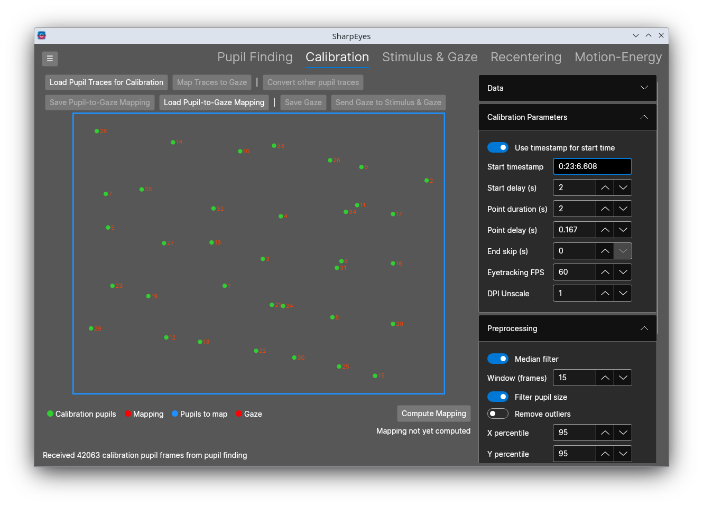

# Calibration

The Calibration tab maps pupil positions in eye video space to gaze positions in stimulus screen space. It takes the pupil positions from a calibration sequence, and fits a radial basis function to map from those positions to the calibration points. The mapping is then applied to pupil traces to produce gaze traces that the [Stimulus & Gaze](stimulus and gaze.md) tab can load.

The screen mostly just shows the pupil positions corresponding to each of the calibration points. After the mapping is computed, it will also show the leave-one-out error for each point.

## Workflow

1. Load pupil traces for the calibration sequence. This can be sent from **Send to Calibration** in the [Pupil Finding](pupil finding.md) tab, which brings over the pupils, timestamps, frame rate, and video size, or loaded with **Load Pupil Traces for Calibration**, which will require you to select the pupil traces and timestaamp files.
2. Set the parameters for the calibration sequence, e.g. start time, duration of each point, and the screen position of each point. The default is the 7 by 5 grid on a 1024 by 768 screen in the standard presentation order. **Regenerate points from stimulus size** rebuilds the grid for a different screen size, and individual points can be edited in the table. As a general check, if the parameters are right, you should get a roughly rectangular grid of dots.
4. Compute the RBFs with **Compute Mapping**. You can change the RBF parameters in the side panel.
5. Check the mapping error and readjust if needed. SharpEyes can also do a grid search over the delay and duration parameters for the calibraiton display sequence with the  **Search delay and duration** button in the Timing search section, and finds th best combo.
6. Map pupil traces to gaze. **Map Traces to Gaze** maps the pupil traces currently held in memory to gaze space. This typically is the same pupil traces you used to compute the mapping. **Convert other pupil traces** loads a separate pupils and maps that over to screen space instead.
7. Click **Save Gaze** to write the gaze traces to a numpy array file, or **Send Gaze to Stimulus & Gaze** to continue in the [Stimulus & Gaze](stimulus and gaze.md) tab.
8. Click **Save Pupil-to-Gaze Mapping** to keep the fitted RBF mappers. **Load Pupil-to-Gaze Mapping** load a saved one back in.

The mapped gaze array is a N x [screen X, screen Y, Pupil radius, confidence] array. Frames that were blinks or had no pupil are NaN. 

## Markers in the bottom left show the state of the mapping computation

| Marker | Red | Blue | Green |
|---|---|---|---|
| Calibration pupils | No calibration traces loaded | | Calibration traces loaded |
| Mapping | No mapping fitted or loaded | | A mapping is ready |
| Pupils to map | No traces loaded at all | Map calibration traces | Map separate traces |
| Gaze | No gaze mapped yet | | Gaze has been mapped from the current mapping |

## How the mapping works

We use a 2D radial basis function to interpolate from pupil video (X, Y) to screen space gaze (X, Y). To evalute the goodness of fit, we do a leave-one-out cross-validation over the points to check the interpolation error. SharpEyes will show you both the error for each point and also the RMS error. As a rough guide, RMS below 20 px is really good, under 40 is find, udner 60 is acceptable, above 60 means the calibration parameters might be off.

We ported the scipy code and mirror both the legacy `RFB` and new `RBFInterpolator` class. The legacy convention is what the [Eyetracking](https://github.com/gallantlab/Eyetracking) Python package used, so a calibration computed here matches one computed there. The `RBFInterpolator` convention adds a polynomial term and uses different kernel definitions and a different smoothing convention.

## Controls reference

### Buttons

| Button | Description |
|---|---|
| Load Pupil Traces for Calibration | Loads a pupils `.npy` and a timestamps `.npy` saved by Pupil Finding as the calibration traces (Ctrl+O) |
| Map Traces to Gaze | Maps the pupil traces currently held by the Pupil Finding tab with the fitted mapping (Ctrl+M) |
| Convert other pupil traces | Loads a separate pupils `.npy` and maps it with the fitted mapping (Ctrl+L) |
| Save Pupil-to-Gaze Mapping | Saves the fitted mapping and the settings that produced it as XML |
| Load Pupil-to-Gaze Mapping | Loads a saved mapping, restores its settings into the sidebar, and refits it |
| Save Gaze | Saves the mapped gaze traces as a `.npy` file |
| Send Gaze to Stimulus & Gaze | Passes the mapped gaze traces and the eyetracking FPS to the Stimulus & Gaze tab |
| Compute Mapping | Aggregates the calibration points, selects the hyperparameters, and fits the mapping |

### Data

| Control | Description |
|---|---|
| Video width / height | Size of the eye video in pixels, filled in when traces are sent from Pupil Finding |
| Blink confidence | Frames whose pupil confidence is below this are treated as blinks and excluded |
| Stimulus width / height | Screen size used by **Regenerate points from stimulus size** |

### Calibration Parameters

| Control | Description |
|---|---|
| Use timestamp for start time | Locate the calibration onset by a timestamp instead of a frame number |
| Start frame | Zero-based frame at which the calibration sequence began |
| Start timestamp | Timestamp of the calibration onset in H:MM:SS.mmm, matched against the parsed video timestamps |
| Start delay (s) | Seconds between the onset and the presentation of the first point |
| Point duration (s) | Seconds each point is shown |
| Point delay (s) | Seconds skipped at the start of each point to allow for the saccade |
| End skip (s) | Seconds skipped at the end of each point |
| Eyetracking FPS | Frame rate of the eye video, used to convert the timing to frames |
| DPI Unscale | DPI scaling factor applied when regenerating the calibration points |

### Preprocessing

Filtering applied to the pupil traces before we compute the RBFs.

| Control | Description |
|---|---|
| Median filter | Apply a bidirectional median filter to the pupil positions |
| Window (frames) | Width of the median filter |
| Filter pupil size | Also filter the pupil radius |
| Remove outliers | Set positions above a percentile to NaN |
| X / Y / Radius percentile | Percentile thresholds for outlier removal |
| Drop unsteady points | Exclude calibration points whose pupil position varied the most during the fixation |
| Variance percentile | Points whose standard deviation on either axis is above this percentile of all points are dropped |

### Interpolator

| Control | Description |
|---|---|
| Legacy Rbf convention / RBFInterpolator convention | Which scipy convention to mirror |
| Kernels | Kernels included in the hyperparameter grid |
| Default shape parameter | Use the convention's default shape parameter; the legacy default is computed from the node spacing |
| Shape parameter | Shape parameter used when the default is switched off |
| Smoothness min / max / count | Smoothness values included in the grid |
| Log spaced smoothness | Space the smoothness values logarithmically; requires both bounds to be positive |

### Timing search

| Control | Description |
|---|---|
| Delay min / max / step (s) | Start delays to try |
| Duration min / max / step (s) | Point durations to try |
| Search delay and duration | Evaluates the hyperparameter grid for every combination, writes the best combination into the sidebar, and refits |

### Results

Shows the kernel, smoothness, and shape parameter of the fitted mapping, and a table with the aggregated pupil position and leave-one-out error of each calibration point. Points with no valid frames have no pupil position and are left out of the fit.

### Calibration points

| Control | Description |
|---|---|
| Regenerate points from stimulus size | Rebuilds the 7 by 5 grid in the standard presentation order from the stimulus size and DPI unscale factor |
| Force redraw points | Redraws the canvas |
| Table | Screen position of each point in the order it was presented |
